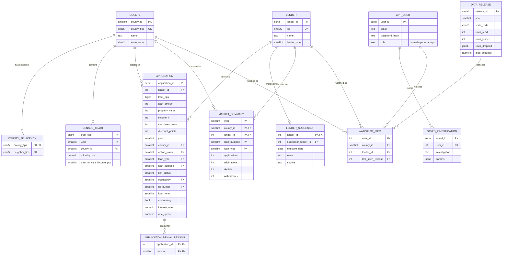

# ER Diagram (draft)

Generated from [`../db/schema.sql`](../db/schema.sql). Keep the two in sync. Lookup tables (`*_code`) are omitted for readability. GitHub renders Mermaid automatically; to export an image use [mermaid.live](https://mermaid.live).

Updated 10/10 for the decisions in [`open-decisions.md`](open-decisions.md): narrow `application` with integer `lender_id` and smallint `county_id` (D10), `lender_successor` (D17), no admin role (D2). The user tables stay empty while Homebuyer and Analyst are guests (D2).

