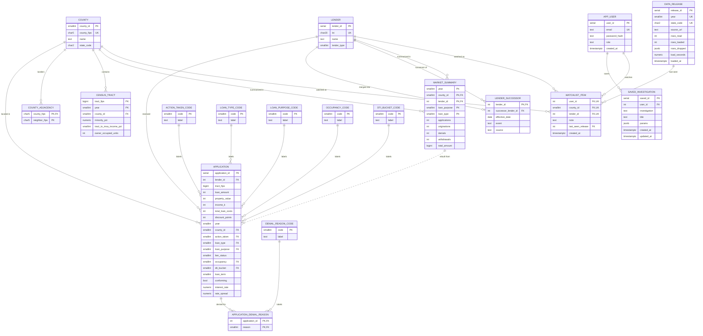

# ER Diagram

Hand-checked against [`../db/schema.sql`](../db/schema.sql) on 10/17. Keep the two in sync: if `schema.sql` changes, change this file in the same PR.

The midterm rubric asks for "key fields, types and keys for **every** table", so this diagram now includes the lookup tables and every column. GitHub renders Mermaid automatically; to export an image use [mermaid.live](https://mermaid.live).

Reading the diagram:
- `||--o{` one-to-many (a county has many applications). `||--o|` one-to-zero-or-one (a lender has at most one successor).
- Solid lines are foreign keys. Dotted lines mean "derived from" (`market_summary` is rebuilt from `application` at each import, D9).
- PK primary key, FK foreign key, UK unique. `char5` means `char(5)`.

## Tables at a glance

Row counts are measured from the 10/10 full load (details and sources in [`data-plan.md`](data-plan.md)).

| Group | Table | Rows | Primary key | Notes |
|---|---|---|---|---|
| HMDA | `application` | 1,537,805 | `application_id` | The 1M+ table. Narrow by design (D10): codes, not text. |
| HMDA | `application_denial_reason` | 319,827 | (`application_id`, `reason`) | Up to 4 reasons per denied application. |
| HMDA | `market_summary` | 107,327 | (`year`, `county_id`, `lender_id`, `loan_purpose`, `loan_type`) | Rebuilt from `application` at each import (D9). |
| Reference | `lender` | 1,269 | `lender_id` | LEI kept once here; `application` stores the 4-byte id. |
| Reference | `lender_successor` | 1 | `lender_id` | Mergers, so "What changed?" doesn't report them as exits (D17). |
| Reference | `county` | 21 | `county_id` | `county_fips` is unique too; the 2-byte id goes in `application`. |
| Reference | `county_adjacency` | 116 | (`county_fips`, `neighbor_fips`) | Neighbors can be in NY, PA or DE, so `neighbor_fips` has no FK. |
| Reference | `census_tract` | 8,464 | (`tract_fips`, `year`) | Tract attributes change with census vintage, so year is part of the key. |
| Reference | `data_release` | 4 | `release_id` | One row per yearly import, with rows read, loaded and dropped. |
| Lookup | `action_taken_code` | 8 | `code` | Code 6 (purchased loan) is dropped at load (D16). |
| Lookup | `loan_type_code` | 4 | `code` | |
| Lookup | `loan_purpose_code` | 6 | `code` | |
| Lookup | `occupancy_code` | 3 | `code` | |
| Lookup | `denial_reason_code` | 9 | `code` | |
| Lookup | `dti_bucket_code` | 19 | `code` | HMDA reports DTI in bins. |
| User | `app_user` | 0 for now | `user_id` | Guests only until accounts are added (D2). |
| User | `saved_investigation` | 0 for now | `saved_id` | |
| User | `watchlist_item` | 0 for now | none (unique on `user_id`, `county_id`, `lender_id`) | Exactly one of `county_id` / `lender_id` is set (CHECK). |

## Where each investigation reads

| Investigation | Main tables | Why |
|---|---|---|
| 1. A loan like mine | `application`, `county`, `lender` | Range filter on `loan_amount`, then lender medians of rate and costs (needs the raw rows). |
| 2. Market vs. its neighbors | `county_adjacency`, `market_summary`, `application_denial_reason`, `denial_reason_code` | Neighbors by lookup; counts from the summary; denial reasons per loan purpose (D19). |
| 3. What changed? | `market_summary`, `lender_successor` | Year-over-year change with `LAG()`; successor table so a merger isn't an exit (D17). |
| Stretch: lending gap | `application`, `census_tract`, `lender` | Share of a lender's loans in majority-minority tracts vs. peers. |
