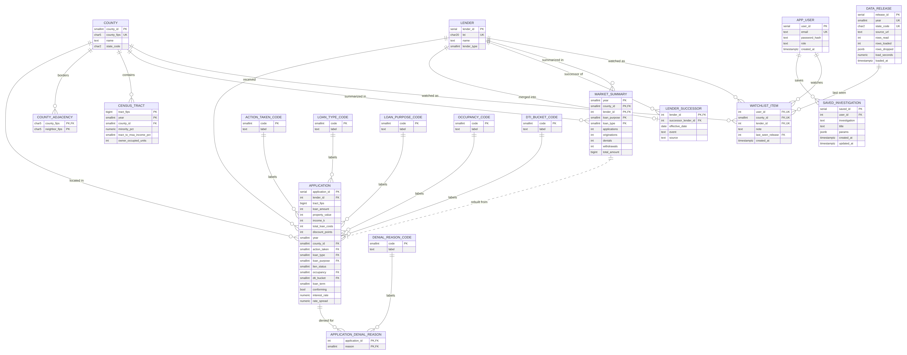

# Midterm: ER Diagram, Schema, Data Plan and Mockups

> The same content as our midterm page on Canvas, kept here so the whole team can see the latest version. Change it with a PR like any other doc.

**Team:** Alex Goferman, Rohan Pant, Junemo Moon, Juhun Kim

## Picking up from our proposal

- Our Proposal page explains the problem, who the app is for, and where the data comes from. This page adds what the midterm asks for: the ER diagram, schema, data plan and mockups.
- The proposal promised real HMDA data, at least 1 million rows, and PostgreSQL. That part is done: New Jersey 2021–2024 is loaded, 1,537,805 applications after cleaning, and the whole database rebuilds from empty in about a minute.
- After the professor's feedback on the proposal, the app is built around four guided investigations that each answer a question: **A loan like mine** (Homebuyer), and **Market vs. its neighbors**, **What changed?** and **Denial patterns** (Analyst).
- Both user types use the site as guests for now. The mockups at the end show one screen for each.

## 1. ER diagram

Click the diagram to open it full size. It is drawn from the Mermaid source in [erd.md](erd.md).

**How to read it**

| Symbol                               | Meaning                                                                                                                 |
|--------------------------------------|-------------------------------------------------------------------------------------------------------------------------|
| Box                                  | One table. The top line is the table's name. Each row below is a column: its type, its name, and its key if it has one. |
| PK                                   | Primary key. It identifies each row, so no two rows share it.                                                           |
| FK                                   | Foreign key. It points to a row in another table.                                                                       |
| UK                                   | Unique. No two rows can have the same value here.                                                                       |
| Solid line                           | A foreign key link between two tables.                                                                                  |
| Dotted line                          | "Rebuilt from". market_summary is recalculated from application at each import. It isn't a key link.                    |
| Two short bars at a line's end       | Exactly one                                                                                                             |
| Circle and bar                       | Zero or one                                                                                                             |
| Circle and three-prong "crow's foot" | Zero or many                                                                                                            |
| Bar and crow's foot                  | One or many                                                                                                             |
| Words on a line                      | What the link means, read from the "one" side, for example a county "contains" census tracts.                           |

**Example:** the line from county to application has two bars at county and a circle with a crow's foot at application. So each application is in exactly one county, and a county can have zero or many applications.

**Types** are PostgreSQL's: smallint, int and bigint are 2-, 4- and 8-byte whole numbers; serial is an int that numbers itself; char5 means char(5), a fixed 5-character code; numeric is an exact decimal; jsonb is JSON; timestamptz is a date and time. The full-size diagram and its source are in [erd.md](erd.md).

## 2. Schema

18 tables in PostgreSQL 16. Full definitions, with every type and constraint: [db/schema.sql](../db/schema.sql).

| Group     | Table                                                                                                     | Rows         | Primary key                                                                    | Notes                                                                                                       |
|-----------|-----------------------------------------------------------------------------------------------------------|--------------|--------------------------------------------------------------------------------|-------------------------------------------------------------------------------------------------------------|
| HMDA      | application                                                                                               | 1,537,805    | application_id                                                                 | The 1M+ table. Narrow by design: numeric codes, not text.                                                   |
| HMDA      | application_denial_reason                                                                                 | 319,827      | (application_id, reason)                                                       | Up to 4 reasons per denied application.                                                                     |
| HMDA      | market_summary                                                                                            | 107,327      | (year, county_id, lender_id, loan_purpose, loan_type)                          | Counts rebuilt from application at each import.                                                             |
| Reference | lender                                                                                                    | 1,269        | lender_id                                                                      | The 20-character LEI is stored once here; application stores a 4-byte id.                                   |
| Reference | lender_successor                                                                                          | 1            | lender_id                                                                      | Mergers, so "What changed?" doesn't report a merged lender as leaving the market.                           |
| Reference | county                                                                                                    | 21           | county_id                                                                      | The 5-character FIPS code is unique here; application stores a 2-byte id.                                   |
| Reference | county_adjacency                                                                                          | 116          | (county_fips, neighbor_fips)                                                   | Neighbors can be in NY, PA or DE, so neighbor_fips has no foreign key.                                      |
| Reference | census_tract                                                                                              | 8,464        | (tract_fips, year)                                                             | Tract attributes change with the census, so year is part of the key.                                        |
| Reference | data_release                                                                                              | 4            | release_id                                                                     | One row per yearly import: rows read, loaded and dropped.                                                   |
| Lookup    | action_taken_code, loan_type_code, loan_purpose_code, occupancy_code, denial_reason_code, dti_bucket_code | 3 to 19 each | code                                                                           | The exact HMDA labels for each code.                                                                        |
| User      | app_user, saved_investigation, watchlist_item                                                             | 0 for now    | user_id, saved_id; watchlist_item is unique on (user_id, county_id, lender_id) | Used once sign-ins are added. A watchlist item watches exactly one county or one lender (CHECK constraint). |

## 3. Data plan

**Sources.** The HMDA public Loan/Application Register (FFIEC/CFPB) for New Jersey, 2021–2024; the HMDA filers list for lender names; and the Census county adjacency file for which counties border which. All data is real and public.

**Cleaning and row counts.** We keep every outcome (originated, denied, withdrawn and so on) except purchased loans, which are loans bought from another lender, not applications. Rows with no NJ county or no loan amount are dropped too, and the count for each reason is stored in data_release.

| Year      | Rows downloaded | Purchased loans dropped | County missing or not NJ | No loan amount | Rows loaded   |
|-----------|-----------------|-------------------------|--------------------------|----------------|---------------|
| 2021      | 707,685         | 78,888                  | 1,959                    | 300            | 626,538       |
| 2022      | 414,459         | 47,487                  | 3,515                    | 312            | 363,145       |
| 2023      | 293,775         | 32,075                  | 1,577                    | 162            | 259,961       |
| 2024      | 323,940         | 33,936                  | 1,704                    | 139            | 288,161       |
| **Total** | **1,739,859**   | **192,386**             | **8,755**                | **913**        | **1,537,805** |

**Loading.** One script downloads the four years and rebuilds the whole database from empty in about a minute (64 seconds on a laptop with Postgres 16). It turns text labels into numeric codes and rebuilds the market summary.

**Size per table.**

| Table                     | Rows      | Table size | Index size               |
|---------------------------|-----------|------------|--------------------------|
| application               | 1,537,805 | 138 MB     | 33 MB (primary key only) |
| application_denial_reason | 319,827   | 11 MB      | 8 MB                     |
| market_summary            | 107,327   | 7 MB       | 4.4 MB                   |
| census_tract              | 8,464     | 0.5 MB     | 0.4 MB                   |
| lender                    | 1,269     | 0.2 MB     | 0.2 MB                   |
| **Whole database**        |           | **211 MB** |                          |

**Who can read and write what.** The server will check the user type on every request, not just hide buttons.

| Data                                                   | Homebuyer                                                                       | Analyst | Import script (run by the team) |
|--------------------------------------------------------|---------------------------------------------------------------------------------|---------|---------------------------------|
| HMDA data (applications, summaries, lenders, counties) | Read                                                                            | Read    | Rebuild from empty              |
| Investigations                                         | Run "A loan like mine"                                                          | Run all | —                               |
| Lender mergers                                         | Read (through results)                                                          | Read    | Write                           |
| Import log (data_release)                              | —                                                                               | Read    | Write                           |
| Users, saved investigations, watchlists | Their own only, once sign-ins are added | Their own only, once sign-ins are added | — |

**Where each investigation reads.**

| Investigation            | Main tables                                                 | Why                                                                                             |
|--------------------------|-------------------------------------------------------------|-------------------------------------------------------------------------------------------------|
| A loan like mine         | application, county, lender                                 | Filters on a loan-amount range, then lender medians of rate and costs, which need the raw rows. |
| Market vs. its neighbors | county_adjacency, market_summary                            | Neighbors by lookup, then counts from the summary.                                              |
| What changed?            | market_summary, lender_successor                            | Year-over-year change with LAG(); the merger table so a merged lender isn't counted as leaving. |
| Denial patterns          | market_summary, application, application_denial_reason      | Denial counts per loan purpose from the summary; reasons by county and lender from the raw rows. |

## 4. Design choices we measured

**A narrow main table.** Our first load kept the public file's shape (text labels, the 20-character lender ID and the county code on every row, purchased loans included) and came to 305 MB, over the ~256 MB the course suggests. Switching to numeric codes and small integer keys, and dropping purchased loans, brought it down 31%.

|                     | First load | Now       |
|---------------------|------------|-----------|
| Rows in application | 1,729,199  | 1,537,805 |
| Bytes per row       | 129        | 94        |
| Whole database      | 305 MB     | 211.6 MB  |

**A summary table instead of counting live.** The data only changes when a new year is imported, so county and lender counts are stored in market_summary. The "What changed?" query, timed both ways (middle value of 7 runs; both return the same rows):

| Rows in application | Counting live | From market_summary |
|---------------------|---------------|---------------------|
| 10k                 | 2.6 ms        | 1.4 ms              |
| 100k                | 17 ms         | 5.2 ms              |
| 1.54M               | 97 ms         | 21 ms               |

**Denial reasons in their own table**, one row per reason instead of four columns, so counting a reason is one GROUP BY. An index we tried for counting live was not used at all (home purchases are 38% of rows, so Postgres read the whole table anyway), so we left it out.

## 5. Mockups

One screen per user type:

- Homebuyer: A loan like mine
- Analyst: Market vs. its neighbors, What changed? and Denial patterns

_Mockup screens go here once they are ready._
